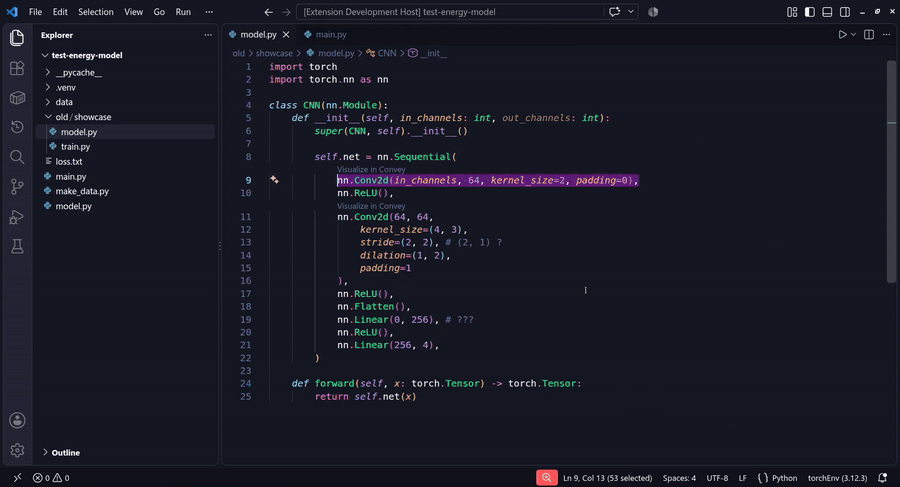
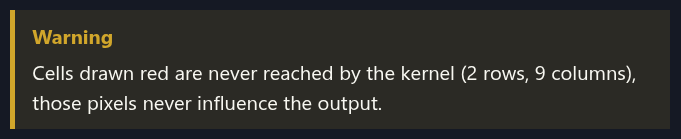
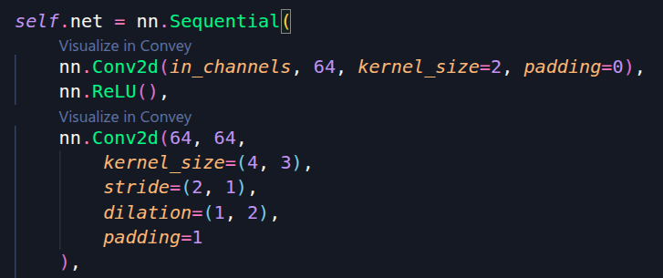

# Convey

See what your **nn.Conv2d** actually does and stop doing convolution math by hand.  
Convey is an interactive visualizer for 2D convolutions inside VS Code: hover to inspect kernel footprints, check output shapes and parameter counts, and spot input cells the kernel never reaches.

<p align="center">
    
</p>

## Features

- **Most common `Conv2d` parameters** - Independent `(H, W)` tuples for `kernel_size`, `stride`, `padding`, and `dilation`, plus `C_in`, `C_out`, and `Bias` (`0` or `1`).
- **Interactive Input & Output Grids** - Edit `WIDTH` / `HEIGHT` and hover over either grid to inspect the exact kernel footprint (including padded cells) and its corresponding output cell, or click **Play Sweep** with a **1x-4x** speed slider to animate the convolution across the feature map.
- **Unreached Cell Detection** - Automatically highlights rows and columns never touched by the kernel in red and warns you how many rows and columns never influence the output.
- **Shape, Parameter & Flatten Math** - Live calculation of:
  - Output dimensions and full `(B, C, H, W)` tensor shapes
  - Learnable parameters: `C_out × (C_in × kH × kW + Bias)`
  - Output features after `nn.Flatten()`: `C_out × H_out × W_out`
- **Large-Grid Overview Mode** - If either side exceeds 64 cells, the grids automatically switch to a proportional overview to continue showing the input and output grids.
- **Python CodeLens & Context Menu Integration** - Automatically detects `Conv2d(` calls (e.g., `nn.Conv2d(...)`, `torch.nn.Conv2d(...)`) in Python files, adding a **Visualize in Convey** CodeLens above the line as well as a right-click editor context menu option `Visualize Conv2d Under Cursor`.
- **Theme-Aware UI** - Adapts to your current VS Code color theme and remembers your last values across panel reloads.

<sub>What the warning looks like when cells aren't touched by the kernel:</sub>  


## Usage

### From Python Code (CodeLens)

Open any `.py` file containing a `Conv2d(...)` call. Convey displays a **Visualize in Convey** CodeLens link directly above the line:



Clicking the CodeLens (or running **Convey: Visualize Conv2d Under Cursor** with the cursor on the `Conv2d(` line) parses the call’s positional and keyword arguments (`in_channels`, `out_channels`, `kernel_size`, `stride`, `padding`, `dilation`, `bias`), as single integers or `(H, W)` tuples, and opens the visualizer beside your editor with those values pre-filled.  
Multi-line calls with single-line comments are also allowed, such as:
```py
torch.nn.Conv2d(64, 64,
    kernel_size=(4, 3),
    # here's a comment
    stride=(2, 1),
    dilation=(1, 2), # another comment
    padding=1
)
```

> **Note:** Non-literal arguments (such as variables or `padding='same'`) fall back to defaults (`C_in=3`, `C_out=64`, `kernel_size=3`, `stride=1`, `padding=0`, `dilation=1`, `bias=True (1)`). You can adjust any parameter directly inside the visualizer panel.

### Standalone Visualizer

Open the Command Palette (`Ctrl+Shift+P` / `Cmd+Shift+P`) and run **Convey: Open Visualizer** to experiment with convolution hyperparameters without any open Python file.

## Commands

This extension contributes the following commands:

| Command | ID | Description |
| :--- | :--- | :--- |
| **Convey: Open Visualizer** | `convey.open` | Opens Convey's 2D Convolution Visualizer beside the active editor. |
| **Convey: Visualize Conv2d Under Cursor** | `convey.openFromCursor` | Parses the `Conv2d(...)` call on the current cursor line and opens it in Convey. |

## Keyboard Shortcuts

Convey does not register default keybindings to avoid conflicting with your setup. If you want a shortcut to visualize the `Conv2d` call on the current line, open **Preferences: Open Keyboard Shortcuts (JSON)** and add an entry like:

```json
[
    {
        "key": "ctrl+alt+v",
        "command": "convey.openFromCursor",
        "when": "editorTextFocus && editorLangId == python"
    }
]
```

*(On macOS, replace `ctrl` with `cmd` or choose any key combination you prefer.)*

## Requirements

- Visual Studio Code **1.74.0** or later.
- No Python runtime or PyTorch installation is required.

## Known Limitations

- **Only `Conv2d` is supported.** Transposed convolutions (`ConvTranspose2d`), pooling layers (`MaxPool2d`, `AvgPool2d`), 1D/3D variants (`Conv1d`, `Conv3d`), and lazy variants (`LazyConv2d`) are not parsed or visualized. Support for some of these may come in the future.
- **Unsupported `Conv2d` parameters:** `groups`, `padding_mode`, and `device`/`dtype` are not parsed or visualized. String padding (`'same'`, `'valid'`) is not supported either.
- **CodeLens & Cursor Parsing:** Only integer literals, `(H, W)` integer tuples, and `True`/`False` for `bias` are parsed (within 8 lines below the opening `Conv2d(`). When using `Convey: Visualize Conv2d Under Cursor` on multi-line calls, place the cursor specifically on the line that contains `Conv2d(`.
- **CodeLens detection is text-based**, not a real Python parse. It looks for the literal text `Conv2d(`, so:
  - Any line containing `Conv2d(` gets a CodeLens, including a class definition named exactly `Conv2d`.
  - Names that merely contain it, like `MyConv2d(`, are ignored.
  - Comments are only ignored when `#` is the first non-whitespace character on the line. Trailing comments and `Conv2d(` inside strings or docstrings will produce a false CodeLens.
- **Large grids (> 64 cells per side):** grids switch to a simplified overview box. Individual unreached cells and dilation gaps are not rendered cell by cell in overview mode.

## Release Notes

See [CHANGELOG.md](CHANGELOG.md) for the full history.